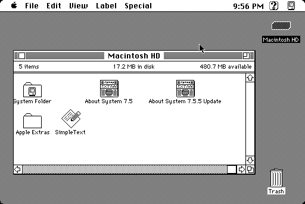
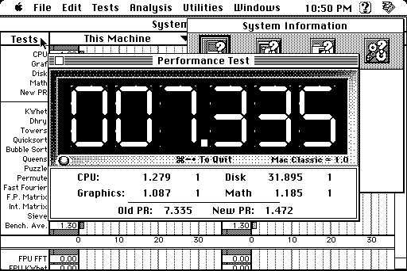
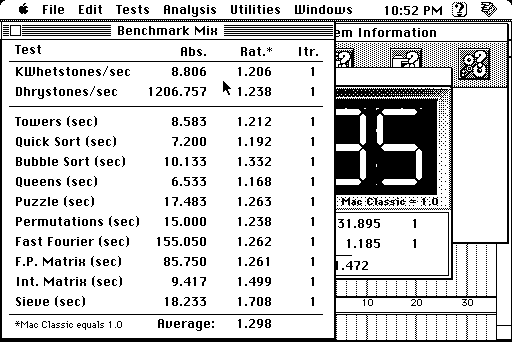
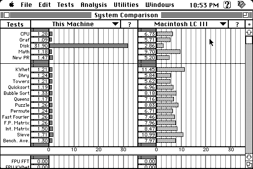
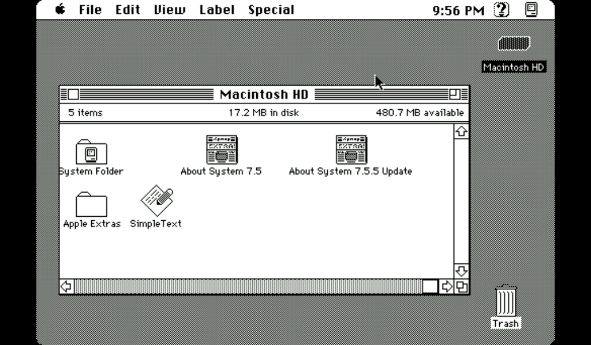
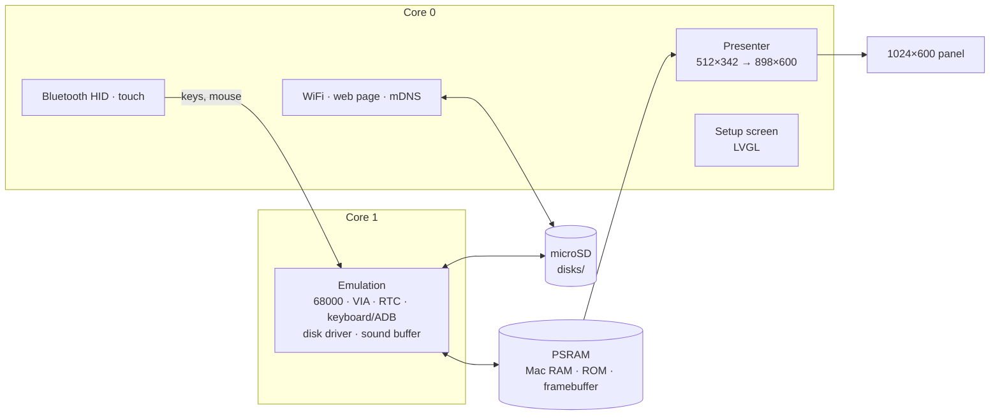

<h1 align="center">esp32mac</h1>

<p align="center">
  <b>A Macintosh Plus, SE or Classic on a 7-inch ESP32-S3 touch-screen board.</b><br>
  68000, up to 4 MB, classic Mac OS, disk images of any size, Bluetooth keyboard and mouse.
</p>

<p align="center">
  
  
  
  
  
</p>

<p align="center">
  
  
  <br>
  
  
  <br>
  <sub>System 7.5.5 on a 500 MB disk image, and Speedometer 3.23 (unpacked from its <code>.sit</code> by the web page) rating the emulated Plus against a Mac Classic: Performance Test, Benchmark Mix, and the comparison with a Macintosh LC III (the disk image on the SD card beats it). Screenshots from the board.</sub>
</p>

esp32mac turns the Makerfabs MaTouch ESP32-S3 Parallel TFT with Touch 7"
into a compact black-and-white Macintosh. The 512×342 screen fills the
panel's height, a Bluetooth keyboard and mouse (or your finger on the screen)
work the Mac, and disk images on the microSD card go into three drives:
floppies and hard disks alike. A setup screen on the touch panel, and a web
page on your network, handle everything else.

It's the sibling of [esp32ste](https://github.com/rlucencic/esp32ste), an Atari STE on the same board;
both are built on the shared runtime [esp32emu](https://github.com/rlucencic/esp32emu).

## Features

**The machine**
- 68000 at 7.83 MHz ([Musashi](https://github.com/kstenerud/Musashi) core), full speed on the board.
  Speedometer 3.23 rates it at 1.3 times a Mac Classic: the emulated CPU
  never waits for the video and sound circuits the way the real one does
- Macintosh Plus, SE or Classic, chosen on the setup screen (from the ROMs you have)
- 1, 2 or 4 MB of RAM
- VIA with its timers, real-time clock with parameter RAM (set from the
  internet, settings kept across power-offs), the sound buffer
- Plus keyboard protocol, or ADB keyboard and mouse on the SE and Classic

**Disks**
- **Three drives** for disk images of any size: 400K/800K/1.4M floppies and
  hard disks up to 2 GB, through a fast replacement of the Mac's disk driver
- Tested with System 7.5.3 on all three models
- Raw images (`.dsk`, `.img`, `.hfv`), Disk Copy 4.2 images (`.image`), and
  partitioned hard disk and CD images (`.hda`, `.iso`, `.toast`)
- **Mac archives straight from the old download sites**: StuffIt (`.sit`,
  `.sea`, 1.5 to 5.x), Compact Pro (`.cpt`), BinHex (`.hqx`) and MacBinary
  (`.bin`) files dropped on the web page are unpacked in your browser and put
  on a disk image of their own, ready to insert (disk images inside an
  archive are used as they are)
- **New blank disks** from the setup screen or the web page (800 KB to 500 MB);
  the Mac offers to initialise them
- Disks inserted while the Mac runs appear on the desktop; ejecting one on
  the Mac frees the drive

**Around it**
- **Touch screen as mouse**: tap to click, drag to drag
- **Setup screen** before the Mac starts, and any time while it runs (hold the
  top-right corner for 2 seconds): WiFi, Bluetooth pairing, model, memory,
  disks, reset
- **Bluetooth keyboard and mouse** (BLE HID), with battery levels
- **Web page** at `http://macintosh.local`: drop disk images, Mac archives or
  `.ZIP` files onto it, put them into drives, eject, make blank disks, and
  watch the Mac, drives, board and Bluetooth devices live
- **Sound** on the board's speaker (optional, `menuconfig`)

## Hardware

| | |
|---|---|
| Board | Makerfabs MaTouch ESP32-S3 Parallel TFT with Touch 7" |
| Module | ESP32-S3-WROOM-1-N16R8: 16 MB flash, 8 MB octal PSRAM |
| Screen | 1024×600 RGB, GT911 capacitive touch |
| Storage | microSD card (FAT32) |
| Input | any BLE keyboard and mouse, or the touch screen |

<p align="center">
  
  <br>
  <sub>The whole 1024×600 panel: the Mac's 512×342 screen scaled to 898×600, square pixels.</sub>
</p>

## Getting started

### 1. What you need

- [ESP-IDF](https://github.com/espressif/esp-idf) v5.5 (developed with v5.5.4)
- [esp32emu](https://github.com/rlucencic/esp32emu), checked out next to this project (`../esp32emu`)
- Macintosh ROM images, which are copyrighted and **not included**: dumps of
  your own Mac Plus (128 KB), SE (256 KB) or Classic (512 KB) ROM. Put them in
  `roms/` as `plus.rom`, `se.rom`, `classic.rom` (see [roms/README.md](roms/README.md)).
- A microSD card, FAT32, and a system disk image (System 6 or 7)

### 2. Build and flash

```sh
git clone https://github.com/rlucencic/esp32emu.git     # the shared runtime, next to it
git clone https://github.com/rlucencic/esp32mac.git && cd esp32mac
idf.py build
idf.py -p /dev/cu.usbmodem… flash      # app and the ROM images
```

Later updates only need `idf.py -p … app-flash`. Instead of flashing the
ROMs, you can also copy them into a `roms` folder on the SD card.

### 3. First start

1. The board starts on the **setup screen**. Tap **WiFi** to join your
   network: the clock is set from the internet, and the web page becomes
   reachable.
2. Open `http://macintosh.local` and drop a system disk image onto the page,
   then choose **Insert into… → Drive 1**.
3. Tap **Bluetooth** to pair a keyboard and mouse (optional: the touch
   screen is a mouse too).
4. Choose the **model** and **memory**, then tap **Start Mac**.

## Using it

| To | Do |
|---|---|
| Get back to the setup screen | Hold the top-right corner of the screen for 2 s |
| Change the model or RAM | On the setup screen; **Restart Mac** applies it |
| Click | Tap the screen, or use the Bluetooth mouse |
| Insert a disk | Web page: **Insert into…**, or setup screen → **Disks** → **Insert disk** |
| Eject a disk | Drag it to the Trash on the Mac (frees the drive), or **Eject** on the web page |
| Make a blank disk | Web page: **New blank disk** (choose the size), or setup screen → **New empty disk** (800 KB) |
| Copy disk images from a computer | Drop them onto the web page (ZIP files are unpacked) |
| Use a program downloaded as `.sit`, `.cpt` or `.hqx` | Drop the file onto the web page: it becomes a disk image named after it (e.g. `Speedometer 3.23.dsk`) |
| …or from the command line | `curl -T System.dsk http://macintosh.local/disks/` |

Disk images live in the `disks` folder on the SD card. The inserted disks
are remembered across restarts, and so is the Mac's parameter RAM (control
panel settings).

Keyboard: Command is the Windows/⌘ key, Option is Alt, Backspace is Delete,
Insert is Help. The Plus keyboard has no Control, Escape or function keys.

## Configuration

`idf.py menuconfig` → **Emulator board**:

| Option | Default | |
|---|---|---|
| WiFi, setup screen | on | Time zone for the clock (POSIX TZ) |
| Start by itself | off | Countdown on the setup screen |
| Web page, network name | on, `macintosh` | `http://<name>.local` |
| BLE keyboard and mouse | on | Mouse speed divider |
| Sound on the speaker | off | Volume; moves the console to the UART port |

## How it works



- **`components/macintosh`**: the Mac, platform independent. It also builds
  on a desktop (`components/macintosh/host`) for testing with scripted mouse
  and keyboard input, screenshots, sound recording and CPU traces.
- **`main`**: the Mac on the board: memory, ROMs, settings, keyboard map,
  touch, drives and status.
- **[esp32emu](https://github.com/rlucencic/esp32emu)**: the board runtime and the 68000 core.

The ROM is patched in memory, with every patch checked against the expected
bytes: no ROM checksum test, a shorter memory test, and the `.Sony` floppy
driver replaced by a small paravirtual one that reads and writes disk images
block by block. That's why any image size works, without emulating the IWM
floppy controller or SCSI. The mouse pointer moves through the Mac's own
cursor variables, like Mini vMac does, so the touch screen can put it
anywhere.

## Development

```sh
make -C components/macintosh/host                                  # desktop build of the Mac
MAC_DISK1=System.dsk components/macintosh/host/build/mac_host roms/plus.rom 3600 out.ppm

python ../esp32emu/tools/emu_console.py /dev/cu.usbmodem… lcd screen.png   # screenshot of the panel
python ../esp32emu/tools/emu_console.py /dev/cu.usbmodem… log 10           # board log
curl http://macintosh.local/api/status                                     # live status as JSON
```

`CLAUDE.md` has the details: architecture, the disk driver, ROM patches,
debugging options and the lessons learned along the way.

## Limitations

- No serial ports, printer, AppleTalk or SCSI devices (disk images take
  their place).
- Disk images are presented through the floppy driver: copy-protected
  originals that talk to the floppy hardware directly don't work.
- Black and white 512×342 only (no Mac II or colour).
- System 7.5.3 refuses the Plus when started from its floppy set (Apple's
  floppy install set doesn't support it); the System on the 7.5.3 CD image,
  or System 6, works.

## Credits

- [Musashi](https://github.com/kstenerud/Musashi) by Karl Stenerud (MIT
  licence), via Matt Evans' [fork](https://github.com/evansm7/Musashi) for
  embedded use
- [Mini vMac](https://www.gryphel.com/c/minivmac/) and Matt Evans'
  [umac](https://github.com/evansm7/umac), the references for how these Macs
  behave and how a paravirtual disk driver fits in
- [The Unarchiver](https://theunarchiver.com)'s XADMaster by Dag Ågren (LGPL), the
  reference for the StuffIt and Compact Pro formats, and Elliot Nunn's
  [machfs](https://github.com/elliotnunn/machfs) (MIT) for the HFS name order
- [LVGL](https://lvgl.io) for the setup screen
- [ESP-IDF](https://github.com/espressif/esp-idf) and NimBLE

## Licence

[MIT](LICENSE). The Musashi core in esp32emu is MIT licensed too. LVGL (MIT)
and ESP-IDF (Apache 2.0) are fetched at build time and keep their own
licences.

The one exception is `main/web/macfiles.js`, the archive converter for the
web page: it follows XADMaster closely, so it is under the
[GNU LGPL 2.1](https://www.gnu.org/licenses/old-licenses/lgpl-2.1.html) or
later.

Apple, Macintosh and Mac are trademarks of Apple Inc. This project contains
no Apple code; you need your own ROM images and system software.
